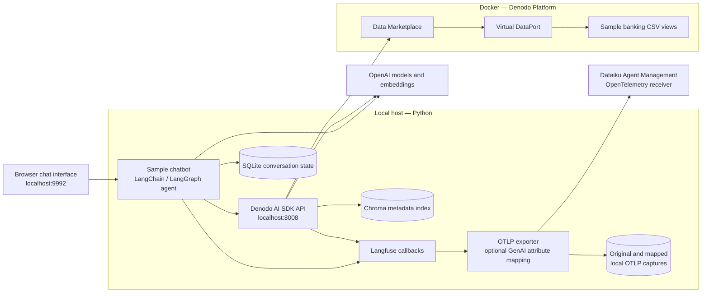

# Denodo Agent Management OpenTelemetry

Run Denodo's Python AI SDK and sample chatbot locally, query sample banking views, and export agent traces to a Dataiku Agent Management (AM) OpenTelemetry receiver.

This repository contains setup scripts and an optional **Langfuse-to-GenAI attribute adapter**. It fetches a pinned version of the official Denodo SDK during setup. It does not include a Denodo platform license, provider credentials, a configured AM endpoint, captured conversations, or third-party application source.

## What this integration does

The SDK's sample chatbot uses **LangChain to run the agent** and **Langfuse callbacks to record its execution**. These are different layers. A custom span exporter routes that telemetry to AM; a Langfuse server or account is not required.

Two export modes are available:

| Mode | Configuration | Behavior |
|---|---|---|
| Native baseline | `DENODO_AM_NORMALIZE=0` | Sends original Langfuse spans without adding GenAI attributes. |
| Compatibility mapping | `DENODO_AM_NORMALIZE=1` | Adds GenAI attributes from existing span data before export. |

In the reference environment, AM discovered the service in native mode but ignored its traces with an unsupported-agent-semantic-convention warning. Compatibility mode resulted in stored interaction rows, including user and conversation identifiers. This is an observation for the tested versions, not a claim that every Denodo or AM deployment behaves the same way.

## Architecture



**The Python agent runs on the host.** Denodo's Java platform runs in Docker and supplies data access and governance. Installing the Java OpenTelemetry agent on the Denodo server is a separate infrastructure-observability configuration and is not part of this setup.

The chatbot can search metadata, generate and execute VQL, and generate graphs. Regular data questions are the focus here. DeepQuery is disabled; no thinking-model backend is configured.

## Reference versions

| Component | Reference configuration |
|---|---|
| Host | Apple Silicon macOS, Python 3.12 |
| Denodo Platform | 9.5.3, official `linux/amd64` image pinned by digest |
| Denodo AI SDK | 1.4, commit `891d83edfc9f2f5984d285b7723abb3079aaa27c` |
| Agent framework | LangChain 1.3.9 / LangGraph 1.2.4 |
| Tracing | Langfuse 4.14.4 / OpenTelemetry 1.38.0 |
| LLM | `gpt-4o-mini` |
| Embeddings | `text-embedding-3-small` |
| Metadata retrieval | Local Chroma |
| Conversation persistence | Local SQLite |

The instructions use a POSIX shell and target macOS/Linux. Full runtime validation was performed on Apple Silicon macOS. Unit tests do not validate other operating systems or provision real Denodo, OpenAI, or AM services.

`requirements-openai.txt` selects the OpenAI/Chroma-related upstream dependencies. The full SDK requirements had conflicting Google/grpc pins in the tested revision. `requirements-openai.lock.txt` records the resolved reference environment; it is a version record, not a universal cross-platform lockfile.

## Prerequisites

- Git, Python 3.12, and [uv](https://docs.astral.sh/uv/).
- A running Docker installation with Compose. The pinned platform image is AMD64; Apple Silicon runs it under emulation. Startup can take several minutes.
- A Denodo Community account with Harbor access and a valid Developer Tier/platform license file. A hosted Denodo environment is not provisioned by these scripts.
- An OpenAI API key with access to the chosen chat and embedding models. Requests and indexing incur provider usage.
- A reachable Dataiku AM node with an **OpenTelemetry Receiver** platform and an API key allowed to **Send OTLP traces**.
- Ports `9090`, `9994`, `9999`, `8008`, and `9992` available locally.

## 1. Clone and fetch the pinned SDK

```bash
git clone https://github.com/drigo10/denodo-agent-management-otel.git
cd denodo-agent-management-otel
python3 scripts/bootstrap.py --python 3.12
```

Bootstrap downloads the SDK into ignored `.runtime/sdk`, checks out the pinned commit, copies our exporter into it, adds a small transport-selection hook to `utils/langfuse.py`, creates a virtual environment, and installs the OpenAI dependency subset. It refuses to patch unexpected tracing code or an SDK checkout at a different revision.

It does not install the Denodo platform natively. The large platform installer download is not needed for the container route; Docker still downloads the container image.

## 2. Configure your own credentials

```bash
cp .env.example .env
```

Edit `.env` locally:

| Variable | What to provide |
|---|---|
| `OPENAI_API_KEY` | Your OpenAI key |
| `OPENAI_MODEL` | Chat model, default `gpt-4o-mini` |
| `OPENAI_EMBEDDING_MODEL` | Embedding model, default `text-embedding-3-small` |
| `DENODO_LICENSE_FILE` | Existing absolute path to your own license file |
| `DENODO_ADMIN_USER` | Local VDP administrator name, normally `admin` |
| `DENODO_ADMIN_PASSWORD` | Your local test administrator password |
| `AM_OTLP_TRACES_ENDPOINT` | Exact full trace URL from the AM receiver's setup panel |
| `AM_API_KEY` | Your AM key with trace-ingestion permission |
| `OTEL_SERVICE_NAME` | Stable service identity, default `denodo-ai-sdk` |
| `DENODO_AM_NORMALIZE` | `1` for compatibility mapping; `0` for native comparison |

Generate the SDK's private configuration:

```bash
.runtime/sdk/.venv/bin/python scripts/configure.py
```

This writes `sdk_config.env` and `chatbot_config.env` inside the ignored SDK checkout, with owner-only file permissions. It uses the standard HTTP/protobuf OTLP exporter and bearer authentication. Placeholder Langfuse project identifiers only initialize the callbacks; the custom exporter targets AM, and media upload is disabled.

Keep `.env`, licenses, `.runtime`, logs, and trace captures out of Git. The ignore rules cover these locations. Trace captures contain prompts, responses, and tool output.

## 3. Authenticate Docker to Denodo Harbor

1. Sign into [Denodo Harbor](https://harbor.open.denodo.com) using **Login via OIDC Provider**.
2. Open your user profile and copy its **CLI secret**.
3. In your own terminal, run:

```bash
docker login harbor.open.denodo.com
```

Use the Harbor profile username and CLI secret, rather than the website password. Terminal does not show characters at the password prompt. If login is unauthorized, confirm the profile username and refresh/recreate the CLI secret through Harbor.

## 4. Start Denodo

```bash
docker compose config --quiet
docker compose up -d
docker compose ps
docker compose logs --tail=100 denodo
```

Wait for the container to become healthy. The first startup deploys Data Marketplace and Design Studio before completing VDP initialization.

| Service | URL / port |
|---|---|
| Design Studio | <http://localhost:9090/denodo-design-studio/> |
| Data Marketplace | <http://localhost:9090/denodo-data-catalog/> |
| Virtual DataPort | `localhost:9999` from the host; `denodo:9999` inside Docker |
| Arrow Flight SQL | `localhost:9994` |

Use the Denodo administrator credentials configured in `.env`. Published ports bind to loopback. Reaching the chatbot from another computer requires a separately planned network and authentication configuration.

If you already have another Denodo container using these ports, stop that environment before starting this one. Changing port numbers also requires updating the local SDK/script connection settings.

## 5. Load the sample banking views

Before starting the chatbot, run:

```bash
.runtime/sdk/.venv/bin/python scripts/load_sample_data.py
```

The script loads the pinned SDK's `samples_bank` views and synchronizes Data Marketplace. It refuses to overwrite an existing `samples_bank` database. Import temporarily uses single-user mode, so perform this only in the isolated local test instance before other users start querying it.

The sample files are mounted read-only into the container. VDP metadata persists in a named Docker volume. Unlike the upstream sample loader, this script skips optional cache configuration: no cache datasource is provisioned. Metadata indexing below uses `examples_per_table=0`, so cached sample-row retrieval is unnecessary.

Sample views include customers, accounts, loans, loan officers, payments, properties, rates, and underwriting.

## 6. Start the Python agent and API

In a terminal kept open for the application:

```bash
cd .runtime/sdk
.venv/bin/python run.py both --timeout 120
```

Open:

- Chatbot: <http://127.0.0.1:9992/>
- SDK API docs: <http://127.0.0.1:8008/docs>

Sign into the chatbot with Denodo credentials. The SDK forwards the caller's credentials to the data layer; data access is governed by Denodo privileges. The application shares its configured OpenAI key across users.

## 7. Index metadata and validate a question

From the repository root in another terminal:

```bash
.runtime/sdk/.venv/bin/python scripts/sdk_request.py index
.runtime/sdk/.venv/bin/python scripts/sdk_request.py ask
```

The first command calls `GET /getMetadata` with `examples_per_table=0`. The second calls `POST /answerQuestion` with a list-form `vdp_database_names` parameter.

For the pinned sample data, **“How many customers are in samples_bank.customer?”** returns **130**. You can also ask in the UI:

- What data is available, and how are customers, accounts, and loans related?
- What is the total balance across all accounts?
- Show the five customers with the highest total account balances.

Natural-language responses and query choice can vary by model. Validate results against the underlying query when evaluating behavior.

## 8. Enable monitoring in Agent Management

1. Create/select an **OpenTelemetry Receiver** platform in AM and use its endpoint in `.env`.
2. Send the first sample question. Refresh the receiver's agent list and find the `OTEL_SERVICE_NAME` you configured.
3. Enable monitoring for that agent and create/select its traces dataset. Leave automatic monitoring of future agents disabled unless you explicitly want it.
4. Send another question **after** monitoring is enabled. Discovery-only traces sent before monitoring are not retained retroactively.
5. In the receiver's Core settings, consider a **5,000 ms idle flush interval** for interactive testing. An inherited 900,000 ms interval can make small tests appear empty for 15 minutes.
6. Check receiver/agent logs, then refresh the dataset's Explore sample. A successful exporter response proves delivery; it does not by itself prove parsing or storage.

You may instead declare the service manually and enable monitoring before sending the first request. The service name must match exactly.

The receiver writes interaction rows; derived conversation/metrics datasets have their own build schedule. Use **Build datasets now** after accepted traces exist to update downstream data. It cannot fix unsupported trace semantics.

### Native versus mapped behavior

Set `DENODO_AM_NORMALIZE=0`, run `scripts/configure.py` again, and restart both Python services to inspect the native baseline. Repeat with `1` to compare compatibility mode. Do not change the service name between modes if you want both tests associated with the same monitored agent.

The exporter always saves original OTLP JSON batches under:

```text
.runtime/sdk/local-data/telemetry/otlp-batches.jsonl
```

Compatibility mode also saves:

```text
.runtime/sdk/local-data/telemetry/otlp-batches-genai.jsonl
```

AM can emit multiple interaction rows from one question because the SDK creates separate pipeline traces. Row count is not necessarily user-question count. See [the mapping details](docs/telemetry.md) for interpretation and limitations.

## 9. Test a second Denodo user

In Design Studio, open **Administration → User management → New user**. Create a **Standard**, **Local** user, then edit privileges:

- Target database `samples_bank`: **Connect, Metadata, Execute**.
- Connection/default database `admin`: **Connect**, when required by the configured Data Marketplace connection.

Use a private browser session to sign into the chatbot as this user. Ask a question and inspect the stored `user` and `conversation_id` fields in AM. Do not grant administrator rights just to populate telemetry identity.

The tested standard-user path produced a distinct username in AM after mapping. This does not establish behavior for every OAuth/token or service-account integration; see [identity troubleshooting](docs/troubleshooting.md).

## Stop and restart

- Python services: type `exit` in the terminal running `run.py`.
- Denodo: `docker compose stop` and `docker compose start`.
- After changing `.env`: rerun `scripts/configure.py`, then restart the Python services. Container environment changes require `docker compose up -d`.
- Named-volume metadata and ignored local Chroma/SQLite state survive ordinary stop/start. Removing Docker volumes removes the stored platform metadata.

## Repository layout

```text
adapters/agent_management_otel.py   Native capture, optional mapping, OTLP export
scripts/bootstrap.py              Fetch and patch the pinned upstream SDK
scripts/configure.py              Generate private local configuration
scripts/load_sample_data.py       Load banking views without cache setup
scripts/sdk_request.py            Index metadata or ask a validation question
tests/                            Offline mapping and setup-contract tests
docs/telemetry.md                  Field mapping, trace interpretation, limits
docs/troubleshooting.md            Authentication, buffering, parser, dataset issues
.env.example                      Placeholder configuration only
compose.yaml                      Licensed local Denodo platform
requirements-openai.txt           Selected direct SDK dependencies
requirements-openai.lock.txt      Reference resolved package versions
.runtime/                         Generated SDK, credentials and data; ignored
```

## Tests

```bash
uv venv .venv --python 3.12
uv pip install --python .venv/bin/python -r requirements-test.txt
.venv/bin/python -m unittest discover -s tests -v
```

Tests run without credentials, Docker, OpenAI, or AM. They verify span identity/hierarchy/timing preservation, usage mapping, original capture, and the pinned-SDK patch contract. Real receiver acceptance still requires an end-to-end request against your own AM environment.

## Scope and references

This is an independent integration example, not an official Denodo or Dataiku connector or a production deployment. Native trace acceptance depends on the SDK, tracing-library and AM versions. The adapter is deliberately explicit and reversible; it does not claim to implement every GenAI semantic-convention field or map every Langfuse observation type.

- [Denodo AI SDK](https://github.com/denodo/denodo-ai-sdk)
- [Denodo installation and Harbor access](https://community.denodo.com/tutorials/browse/installation/index)
- [Denodo container configuration](https://community.denodo.com/kb/en/view/document/denodo%20docker%20container%20configuration)
- [Denodo AI SDK manual](https://community.denodo.com/docs/html/document/denodoconnects/9.4/en/Denodo%20AI%20SDK%20-%20User%20Manual)
- [Dataiku AM OpenTelemetry receiver](https://doc.dataiku.com/agent-management/latest/supported-platforms/opentelemetry.html)

See [third-party information](THIRD_PARTY.md) for upstream ownership and license boundaries.

No license has been selected for this repository's integration code. Public availability alone does not grant a general open-source reuse license. Third-party components retain their own licenses.
